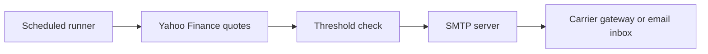

# Stock market alerts

Monitor large stock moves during US premarket, regular trading, and postmarket hours. Send the ticker, price, direction, percentage change, and session through your SMTP account to carrier email-to-text addresses and/or ordinary email recipients.

A threshold of `.10` means a 10% move in either direction. The monitor uses Yahoo's session-specific change: regular trading compares with the previous close; premarket/postmarket compare with Yahoo's reference close for that session. It does not calculate an intraday high-to-low move or combine changes across sessions.



## Run locally

Use Python 3.11 or newer:

```bash
python3 -m venv .venv
source .venv/bin/activate
python -m pip install -r requirements.txt

# Avoid putting the app password in shell history or process arguments.
read -rs SENDER_EMAIL_PASSWORD
export SENDER_EMAIL_PASSWORD

python main.py \
  --stock_symbols MSFT AAPL GOOG \
  --percent_change_threshold .10 \
  --sender_email your_email@gmail.com \
  --sender_email_host smtp.gmail.com \
  --sender_email_host_port 587 \
  --carrier verizon_pics \
  --phone_numbers 2025550100
```

For Gmail, create an [app password](https://support.google.com/accounts/answer/185833). Port 587 uses required STARTTLS; port 465 uses implicit TLS. Certificate validation remains enabled.

All connection, watchlist, and destination arguments also accept uppercase environment variables of the same name (for example `STOCK_SYMBOLS`, `PERCENT_CHANGE_THRESHOLD`, and `SENDER_EMAIL_PASSWORD`). List variables contain whitespace-separated values; command-line arguments override environment variables. At most five unique tickers are accepted; larger lists fail clearly instead of silently dropping symbols.

To send directly to email, add `--recipient_emails you@example.com another@example.com`. This can be used alongside phone numbers, or on its own without `--carrier` and `--phone_numbers`.

`--yahoo_api_key` is accepted for compatibility but ignored. The pinned `yahooquery` library uses Yahoo's public endpoints; assigning `Ticker.api_key` did not authenticate requests to financeapi.net. No paid API key or `YAHOO_API_KEY` secret is required.

## Alert behavior and failures

- Checks run every 10 seconds during weekdays, 4:00 a.m.–8:00 p.m. in `America/New_York`, including daylight saving changes. Session boundaries are 9:30 a.m. and 4:00 p.m.
- Each recipient gets at most one accepted alert per ticker **per direction per Eastern date**. A later reversal can therefore alert DOWN after an UP alert. The next day's alerts reset automatically.
- SMTP acceptances are saved atomically in `alert-state.json`. Keep this file when restarting locally; use `--state_file /path/to/state.json` for a persistent container volume. It contains the Eastern date and hashed alert identifiers, with no addresses or SMTP credentials in plain text.
- Failed recipients remain queued in memory and retry with backoff, including if the stock retraces below the threshold. Recipients already accepted by SMTP are not resent. Pending messages are not persisted across process crashes.
- Quote/network/SMTP calls have timeouts. Five consecutive checks with quote or delivery errors fail the process and CI visibly; SMTP authentication errors fail immediately. A bounded run also fails if it ends with unresolved errors. Healthy symbols are still evaluated in a check where another symbol fails.
- Quotes from previous dates or other market sessions are ignored. This avoids replaying stale extended-hours values and previous-day quotes on holidays. This is a weekday/session clock, not a full exchange holiday or early-close calendar; it keeps polling on those days.

`--poll_interval 30` adjusts polling. `--max_runtime_seconds 300` bounds a run. `--exit_at_market_close` exits at 8 p.m. Eastern or on weekends; without it, a local process waits through quiet hours and resumes the next trading day.

SMTP acceptance does **not** confirm delivery to a phone. Carrier filtering, gateway delays, a crash between SMTP acceptance and saving state, or lost/expired state can still cause missing or duplicate alerts.

## GitHub Actions monitoring

Fork this repo and configure these repository secrets:

| Secret | Value |
| --- | --- |
| `stock_symbols` | Up to five symbols, separated by spaces |
| `percent_change_threshold` | For example `.10` |
| `sender_email` | SMTP account email |
| `sender_email_host` | For example `smtp.gmail.com` |
| `sender_email_host_port` | `587` or `465` |
| `sender_email_password` | SMTP/app password |
| `carrier` | Carrier name, if sending to phones |
| `phone_numbers` | Ten-digit US numbers separated by spaces, if sending to phones |
| `recipient_emails` | Optional direct email destinations separated by spaces |

The [monitor workflow](.github/workflows/cron.yml) queues an independent run hourly at :50 from 3:50 a.m. through 7:50 p.m. Eastern, Monday–Friday. The early trigger allows setup before 4 a.m.; GitHub may delay or drop scheduled runs, so exact coverage is not guaranteed. GitHub can also disable scheduled workflows in public repositories after 60 days without repository activity; check the Actions tab if monitoring stops.

Only one monitor runs at a time. Later triggers wait without cancelling the active monitor; GitHub may replace older pending runs with newer ones. Each monitor runs for up to 345 minutes or until 8 p.m., then saves state for its queued replacement. Runner setup creates a brief handoff gap. Independent triggers recover from a broken run on the next queued/hourly start without requiring a personal access token or Actions write permission. Manually dispatching the workflow queues a replacement; it does not interrupt the active monitor. Monitoring runs only from the default branch.

The workflow restores the newest state artifact from this workflow on the default branch and uploads state even after a failure. Artifacts are retained for three days. Check failed monitor runs in Actions and enable GitHub Actions failure notifications. The separate [test workflow](.github/workflows/test.yml) validates pull requests on Python 3.11 and 3.12 without sending messages or querying Yahoo.

## Carrier gateways

Existing compatibility names are below; availability depends on the carrier.

| Carrier name | Gateway |
| --- | --- |
| `verizon` | `vtext.com` |
| `verizon_pics` | `vzwpix.com` |
| `tmobile` | `tmomail.net` |
| `sprint` | `messaging.sprintpcs.com` |
| `at&t` | `txt.att.net` |
| `boost` | `smsmyboostmobile.com` |
| `cricket` | `sms.cricketwireless.net` |
| `uscellular` | `email.uscc.net` |

Verizon [announced the retirement of Vtext/VZWPix](https://www.verizon.com/support/vtext-vzwpix-shutdown/), with completion anticipated by March 31, 2027 and some senders losing access sooner. Confirm actual phone delivery and consider a direct email destination with phone notifications as another route.

## Development

```bash
python -m unittest discover -s tests -v
```

Tests mock Yahoo and SMTP. They cover both alert directions, session boundaries, daylight saving time, malformed/stale quotes, per-recipient retry, reversals, daily resets, restart suppression, SMTP refusal/authentication, runtime failure reporting, and artifact selection.

The AWS Terraform/ECS files and manual deploy workflow are a legacy deployment sketch; they are separate from the tested GitHub Actions monitor and require additional configuration before use.

Credits: [yahooquery](https://github.com/dpguthrie/yahooquery), [aiosmtplib](https://github.com/cole/aiosmtplib), and the original [email-to-text example](https://github.com/acamso/demos/blob/master/_email/send_txt_msg.py).
